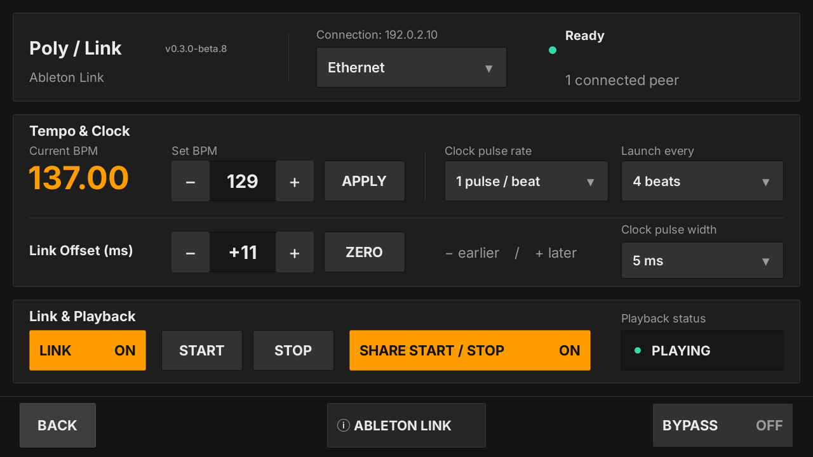

# Poly / Link for Poly Effects Hector

Ableton Link Sync lets Hector follow or share tempo with Link apps on your local network and send clock and transport signals to your patch.

**Public beta v0.3.0-beta.8 · Hector firmware 4.0.7 · Network Connection required**

[Download the signed USB installer](https://github.com/jahmontee/ableton-link-module/releases/download/v0.3.0-beta.8/Poly-Link-Sync-Hector-0.3.0-beta.8-USB.zip) · [Release notes and checksums](https://github.com/jahmontee/ableton-link-module/releases/tag/v0.3.0-beta.8) · [All releases](https://github.com/jahmontee/ableton-link-module/releases)

*The editor screenshot uses example connection and peer data.*

## What it does

- Follows and shares tempo with Ableton Link apps such as AUM over Ethernet or Wi-Fi.
- Sends Clock, Run, Start Reset, and Phase signals. Choose the clock rate, pulse width, launch quantum, and timing offset in the editor.
- Shares Start and Stop when the participating apps enable that option.
- Provides 1, 5, and 10 ms clock pulses. Hermod followed Hector in the hardware test with the width set to **5 ms**.

## Install and use

Install [Network Connection / Poly / View v0.2.0-beta.1](https://github.com/jahmontee/network-connection-poly-view/releases/tag/v0.2.0-beta.1) on Hector firmware **4.0.7** first. Configure Ethernet or Wi-Fi and connect Hector and your Link app to the same network.

- **USB.** Save your patch, extract the signed ZIP to the root of a FAT32 drive, and check that `debug.sh` is at the root. Power Hector off, insert the drive, and power it back on. Leave it inserted through the automatic restart.
- **Poly / View.** Open **Module Manager → Release packages → Upload ZIPs** and select the same original ZIP. Choose **Install** or **Update**, then confirm your patch is saved. Hector restarts automatically.
- **Use.** Add **Ableton Link** in Hector’s picker. Select your connected interface in the Poly / Link editor, turn Link on, and enable Link in the other app. Patch **Clock** to your sequencer’s clock input.

See [removal and recovery](docs/RECOVERY.md) for how removal handles saved patches.

## Source and credits

[Build notes](docs/BUILD.md) describe the module source, binary checksums, and shared installer sources. See [credits and licenses](CREDITS.md) for upstream acknowledgments.
